# Refract 3.0.2

[](https://github.com/sitien173/refract/actions/workflows/server.yml)

[](https://github.com/sitien173/refract/actions/workflows/plugin.yml)

[](https://cf-api-gateway.sitienbmt.workers.dev/sonarqube/summary/new_code?id=refract)

[](LICENSE)

Plan with one coding agent, implement and review with others.

Refract runs coding work through three gates: **Plan, Execute, Review**. Your interactive agent acts as the Coordinator. It brainstorms and plans with you, hands implementation and independent review to worker CLIs, and keeps ownership of every Git commit and verification step.

## Overview

Refract has two parts:

- **Plugin** in [`plugin/`](plugin): skills, slash commands, and a SessionStart hook for Claude Code, Antigravity, Codex, and Pi.
- **Server** in [`server/`](server): a local daemon that queues jobs, routes them to worker CLIs, and exposes them over MCP and a web dashboard.

### Architecture



### Data flow



### Features

- **Three-gate workflow.** Brainstorm a design, write a phase plan, then execute and review each phase.
- **Four worker backends.** Route jobs to Codex, Claude Code, Pi, or Antigravity CLIs.
- **Profiles with fallback.** Map each workflow to an ordered list of targets. A circuit breaker skips unhealthy targets.
- **Independent review.** Profiles can send review to a different target from implementation.
- **Parallel waves.** Plan phases can declare dependencies. Independent phases run in separate Git worktrees.
- **Durable jobs.** Jobs, sessions, and results persist in a local SQLite store. Jobs running during a restart are marked `interrupted` and can be retried.
- **Worker questions.** A worker can ask the Coordinator a question mid-job with `refract ask`.
- **Live dashboard.** Watch transcripts, cancel, retry, and answer jobs at `http://127.0.0.1:8765/dashboard/`.

### Requirements

- Python 3.12 or newer
- [uv](https://docs.astral.sh/uv/)
- Git
- At least one worker CLI on `PATH`: `codex`, `claude`, `pi`, or `agy`
- A host agent for the plugin: Claude Code, Antigravity, Codex, or Pi

## Quick start

### 1. Install the server

```bash
uv tool install "refract @ git+https://github.com/sitien173/refract#subdirectory=server"
```

### 2. Configure targets and profiles

Create `~/.refract/config.toml`. Start from [`server/config.v3.toml`](server/config.v3.toml), which shows every supported key:

```toml
[daemon]
default_profile = "base"

[[targets]]
id = "codex-code"
backend = "codex"
reasoning = "high"

[[targets]]
id = "claude-review"
backend = "claude"
model = "sonnet"
isolated = true
read_only = true

[profiles.base]
implement = "codex-code"
review = "claude-review"
consult = ["claude-review", "codex-code"]
```

> [!TIP]
> In Claude Code, run `/refract:setting-up-refract` after installing the plugin. It scans your worker CLIs and writes this file with you.

### 3. Check and start the daemon

```bash
refract doctor
refract serve
```

`refract doctor` exits 0 when the state directory is writable and every target executable resolves. The daemon listens on `http://127.0.0.1:8765/mcp`.

### 4. Install the plugin

Run `refract install` with the host you use:

```bash
refract install -p claude
refract install -p claude,codex,pi
refract install -p all
```

`-p` takes `claude`, `codex`, `agy`, `agy-ide`, `pi`, or `all`. Pass a comma list or repeat the flag. `all` means every host CLI found on PATH, plus `agy-ide` when the Antigravity IDE is present. Add `--dry-run` to print the planned commands without running them. Use `refract uninstall -p <host>` to remove the plugin. See the Installing section of [`plugin/README.md`](plugin/README.md) for scopes and sources.

For the standalone Antigravity IDE, which has no plugin CLI, `refract install -p agy-ide` copies the plugin (cloned from GitHub, or from a local clone passed with `--source /path/to/refract`) into `~/.gemini/config/plugins/refract/`. This is the one host where Refract writes files into your home directory itself. It marks what it copies and refuses to delete a directory it did not install. Antigravity does not load plugin slash commands, so invoke the skill names instead. See the Antigravity IDE section of [`plugin/README.md`](plugin/README.md).

To install by hand, use the host's own commands.

Claude Code:

```bash
claude plugin marketplace add sitien173/refract
claude plugin install refract@refract
```

Codex:

```bash
codex plugin marketplace add sitien173/refract
codex plugin add refract@refract
```

Antigravity:

```bash
agy plugin install https://github.com/sitien173/refract
```

Pi:

```bash
pi install https://github.com/sitien173/refract
```

When the daemon is not running, the plugin's SessionStart hook starts `refract serve` in the background.

### 5. Run the workflow

| Command | Purpose |
| --- | --- |
| `/refract:brainstorm <idea>` | Clarify intent and trade-offs, then write a design. |
| `/refract:write-plan <design>` | Turn a confirmed design into a phase plan. |
| `/refract:execute-plan [target]` | Run one wave of phases through all three gates. |
| `/refract:execute-plan-all [target]` | Run every wave through final audit without pausing. |

In Pi, drop the `refract:` prefix, for example `/brainstorm`.

## Workflows

Each job runs one workflow. A profile maps workflows to targets.

| Workflow | Use |
| --- | --- |
| `implement` | Repository changes |
| `review` | Independent verification of a change |
| `consult` | Read-only analysis and second opinions |
| `other` | Anything else; requires an explicit mapping and never falls back |

## Run without Refract

Set `REFRACT_DISABLE=1` to skip the daemon check and tell the host agent to ignore Refract for that session:

```bash
REFRACT_DISABLE=1 claude -p "Summarize this repository"
```

## Repository layout

```text
plugin/     host plugin: skills, commands, hooks, Pi extension, contract tests
server/     daemon, CLI, MCP tools, and dashboard
server/web/ dashboard source; builds into server/src/refract/dashboard_static/app
scripts/    release tooling
docs/       architecture diagrams and design plans
```

## Development

```bash
# Server tests
cd server && uv sync --all-extras && uv run pytest

# Plugin contract tests
plugin/tests/run.sh

# Dashboard checks
cd server/web && pnpm install && pnpm run typecheck && pnpm run lint && pnpm exec vitest run
```

See [`AGENTS.md`](AGENTS.md) for repository conventions.

## Documentation

- [Plugin guide](plugin/README.md): host setup, disabling Refract, updates, skills
- [Server guide](server/README.md): configuration, CLI, MCP tools, dashboard
- [Backend CLI arguments](server/CLI_ARGUMENTS.md): flags each backend accepts and which ones Refract owns
- [Changelog](CHANGELOG.md)
