# Refract

Plan with one coding agent, implement and review with others.

Refract runs coding work through three gates: **Plan, Execute, Review**. Your interactive agent acts as the Coordinator. It brainstorms and plans with you, hands implementation and independent review to worker CLIs, and keeps ownership of every Git commit and verification step.

## Overview

Refract has two parts:

- **Plugin** in [`plugin/`](https://github.com/sitien173/refract/blob/main/plugin): skills, slash commands, and a SessionStart hook for Claude Code, Antigravity, Codex, and Pi.
- **Server** in [`server/`](https://github.com/sitien173/refract/blob/main/server): a local daemon that queues jobs, routes them to worker CLIs, and exposes them over MCP and a web dashboard.

## Architecture

## Features

- **Three-gate workflow.** Brainstorm a design, write a phase plan, then execute and review each phase.
- **Four worker backends.** Route jobs to Codex, Claude Code, Pi, or Antigravity CLIs.
- **Profiles with fallback.** Map each workflow to an ordered list of targets. A circuit breaker skips unhealthy targets.
- **Independent review.** Profiles can send review to a different target from implementation.
- **Parallel waves.** Plan phases can declare dependencies. Independent phases run in separate Git worktrees.
- **Durable jobs.** Jobs, sessions, and results persist in a local SQLite store. Jobs running during a restart are marked `interrupted` and can be retried.
- **Worker questions.** A worker can ask the Coordinator a question mid-job with `refract ask`.
- **Live dashboard.** Watch transcripts, cancel, retry, and answer jobs at `http://127.0.0.1:8765/dashboard/`.

## Requirements

- Python 3.12 or newer
- [uv](https://docs.astral.sh/uv/)
- Git
- At least one worker CLI on `PATH`: `codex`, `claude`, `pi`, or `agy`
- A host agent for the plugin: Claude Code, Antigravity, Codex, or Pi

Source: [README.md](https://github.com/sitien173/refract/blob/main/README.md)
